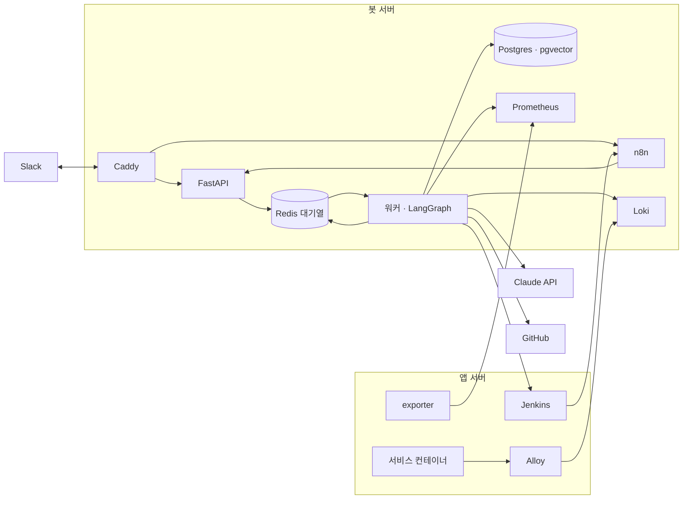

# 프로젝트 봇

Slack에 에러를 붙여 넣으면 원인을 분석하고, 코드 문제면 고친 PR까지 올려 주는 장애 대응 봇입니다.
설정 파일만 바꾸면 다른 프로젝트에도 붙일 수 있습니다. 적용 예시는 [examples/sudaduck](examples/sudaduck)에 있습니다.

## 하는 일

| 기능 | 설명 |
|---|---|
| 오류 분석 | 붙여 넣은 에러에서 API와 시각을 뽑고, 그 시각의 서버 로그와 스택 트레이스를 찾아 관련 코드를 읽은 뒤 원인을 보고합니다 |
| AI로 수정 | 수정 코드와 재현 테스트를 만들고, Jenkins에서 "수정 전 실패, 수정 후 통과"를 확인한 뒤 PR을 올립니다. merge는 사람이 합니다 |
| 질문·조회 | "방 입장 코드 어디야", "최근 30분 에러 보여 줘" 같은 질문에 코드, 로그, 지표, 문서, 장애 기록을 찾아 답합니다 |
| 배포 알림 | 배포 시작, 성공, 실패를 알리고, 실패하면 버튼 없이 바로 원인 분석을 시작합니다 |
| 코드 갱신 | 배포가 성공하면 바뀐 코드만 다시 읽어 검색용 DB를 최신으로 맞춥니다 |

## 구조



- **FastAPI 서버**는 요청을 받아 대기열에 넣고 바로 응답합니다. 분석과 수정은 수십 초에서 몇 분이 걸려서 **워커**가 따로 실행합니다.
- **Slack 요청**은 서명 검증에 본문 원본이 필요해서 Caddy가 API로 바로 넘깁니다. **Jenkins, GitHub 알림**은 n8n이 받아 API로 넘깁니다.
- **Postgres**에는 코드 청크, 콜 그래프, 문서, 장애 기록, 작업 상태가 들어갑니다. 원본 코드는 Git에 있고 DB는 검색용 사본입니다.
- **Redis**는 대기열과 코드 캐시로 씁니다.

## 코드를 찾는 방법

배포할 때마다 [tree-sitter](https://tree-sitter.github.io/)로 코드를 읽어 두 가지를 만듭니다.

- **청크** (`code_chunk`): 메서드, 함수, 컴포넌트 하나가 한 행입니다. 코드 원문, 한국어 한 줄 설명, 벡터가 들어갑니다.
- **콜 그래프** (`call_edge`): "A가 B를 호출한다"가 한 행입니다.

프론트와 백엔드는 API 경로로 이어집니다.

```
RoomPage.jsx#loadRoom → GET /api/v1/rooms/{} → RoomController#getRoom → RoomService#findRoom
      (프론트)              (API 경로)              (백엔드)
```

에러 분석에서는 스택 트레이스의 메서드 이름으로 청크를 바로 찾고, 콜 그래프로 호출 대상까지 읽습니다.
"방 입장 코드 어디야"처럼 이름이 없는 질문에는 키워드 검색과 벡터 검색을 합쳐서(RRF) 찾습니다.
벡터는 코드 전체가 아니라 "한국어 설명 + 시그니처"로 만듭니다. 한국어 질문과 영어 코드를 맞추기 위해서입니다.

## 안전장치

- 봇이 할 수 있는 일은 읽기(로그, 지표, 코드)와 수정 브랜치 push, PR 생성뿐입니다. 서버 명령, 배포, merge, 운영 DB 접근은 하지 않습니다.
- AI는 코드와 테스트를 쓰기만 합니다. 실행과 판정은 Jenkins가 합니다.
- 재현 테스트는 수정 전 코드에서 실패하고 수정 후 코드에서 통과해야 인정합니다. 재시도 때 테스트는 바꾸지 못합니다.
- 수정은 서비스의 소스 폴더 안에서만 할 수 있습니다. 빌드·배포·환경 설정 파일은 고칠 수 없습니다.
- 문서를 저장할 때 비밀번호, 키, 토큰으로 보이는 값은 가립니다.
- Slack 요청은 서명을 검증하고, Jenkins·GitHub 알림은 미리 정한 값으로 확인합니다.

## 적용 조건

- GitHub 저장소, Jenkins, Docker로 배포하는 프로젝트
- 서비스가 로그를 콘솔에 출력 (스택 트레이스 포함)
- 언어: Java(Spring), JavaScript(React). 다른 언어는 `bot/adapters`에 처리기를 추가하면 됩니다
- Slack 워크스페이스

## 설치

1. **봇 서버**에 이 저장소를 받고 `.env.example`을 `.env`로, `project.example.yml`을 `project.yml`로 복사해 값을 채웁니다.
2. 봇 서버를 띄웁니다.
   ```bash
   docker compose up -d --build
   ```
3. **앱 서버**에 수집기(Alloy, node-exporter, cAdvisor)를 띄우고 Loki 주소를 봇 서버로 지정합니다. 컨테이너에 `service` 라벨을 붙이면 그 값이 로그의 서비스 이름이 됩니다.
4. **Jenkins** 파이프라인에 시작·성공·실패 알림을 추가하고, 봇의 수정 브랜치를 테스트하는 작업(`test-branch`)을 만듭니다.
5. **Slack 앱**을 `slack/manifest.example.yml`로 만들고 Bot Token과 Signing Secret을 `.env`에 넣습니다.
6. n8n 워크플로를 넣습니다.
   ```bash
   docker compose exec n8n n8n import:workflow --input=/files/jenkinsDeploy01.json
   docker compose exec n8n n8n publish:workflow --id=jenkinsDeploy01
   ```
7. 코드를 처음 한 번 읽어 들입니다.
   ```bash
   docker compose exec api python -m bot index     # 청크와 콜 그래프
   docker compose exec api python -m bot enrich    # 한국어 설명과 벡터
   docker compose exec api python -m bot docs      # 문서
   ```

## 설정 (project.yml)

```yaml
project: sudaduck
repo:
  url: https://github.com/DooDooLee/sudaDUCK
  branch: develop
services:
  - name: backend
    path: backend
    language: java
    source_dirs: [src/main/java]
    base_packages: [com.example.DuckDuck]   # 스택 트레이스에서 우리 코드를 고르는 기준
  - name: frontend
    path: frontend
    language: javascript
    source_dirs: [src]
    aliases: {"@": "src"}
docs: [README.md]
```

## 새 언어 추가

`bot/adapters/base.py`의 `LanguageAdapter`를 구현합니다.

| 메서드 | 하는 일 |
|---|---|
| `extract_chunks` | 코드를 메서드·함수 단위로 자르기 |
| `extract_calls` | 호출 관계 뽑기 |
| `extract_routes` | API 경로 뽑기 (처리하는 쪽, 호출하는 쪽) |
| `parse_stack_trace` | 스택 트레이스에서 우리 코드의 줄 뽑기 |

구현체를 `bot/adapters/__init__.py`에 등록하면 나머지 코드는 고치지 않아도 됩니다.

## 폴더

```
bot/
  api/         FastAPI 서버 (Slack, Jenkins, GitHub 요청 수신)
  worker/      대기열에서 일을 꺼내 실행
  analysis/    오류 분석(LangGraph), 질문·조회(도구 8개)
  fix/         AI 수정 흐름
  adapters/    언어 처리기 (Java, JavaScript)
  indexing/    청크·콜 그래프 생성, 설명·벡터 생성, 문서
  tools/       Loki, Prometheus, Jenkins
  db/          Postgres 저장과 조회
db/schema.sql  테이블
deploy/        Caddy, Prometheus 설정
n8n/workflows  n8n 워크플로
slack/         Slack 앱 설정
scripts/       배포, 테스트, Slack 시험 도구
examples/      적용 예시
tests/         테스트
```

## 테스트

```bash
docker run --rm -v "$PWD:/app" project-bot python -m pytest -q
```

Slack 없이 전체 흐름을 시험하려면 `scripts/simulate_slack.py`를 씁니다. Slack이 보내는 것과 같은 모양의 요청에 서명을 붙여 보냅니다.

```bash
python scripts/simulate_slack.py mention "POST /api/v1/rooms 500 에러가 나요"
python scripts/simulate_slack.py click <스레드 ts> analyze_error
python scripts/simulate_slack.py show <스레드 ts>
```
